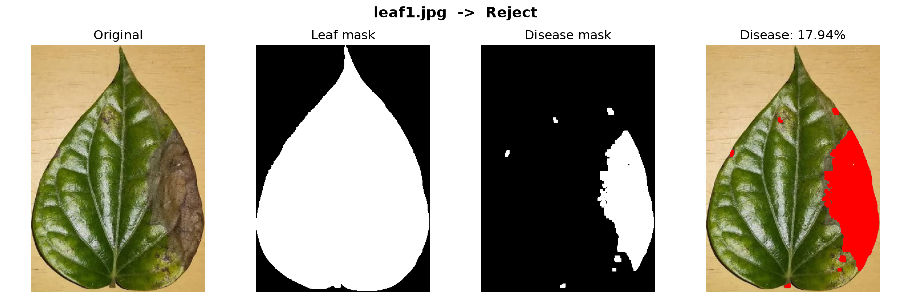
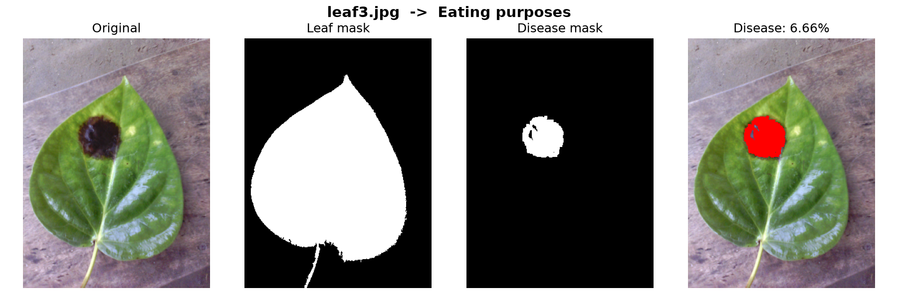
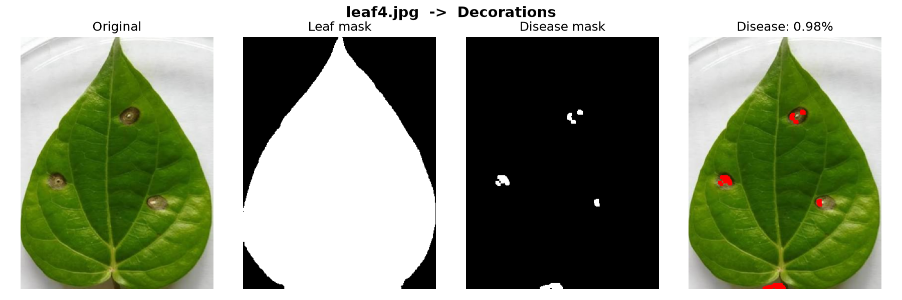
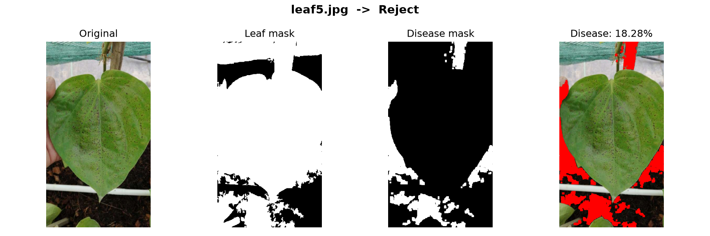

# Betel Leaf Disease Detector and Categorizer

A Python + OpenCV tool that finds the diseased area on a betel leaf photo,
calculates what percentage of the leaf is diseased, and sorts the leaf into a
market category.

| Diseased area | Category |
|---|---|
| 10% or more | **Reject** |
| 5% to under 10% | **Eating purposes** |
| under 5% | **Decorations** |



## How it works

The detector uses classic image processing (colour thresholding), not machine learning.

1. **Resize** every photo to 300 px wide, so the same settings behave the same
   way regardless of camera resolution.
2. **Convert to HSV.** HSV separates *which colour* (Hue) from *how bright*
   (Value), which makes "find the green parts" a simple range check.
3. **Find the leaf.** Pixels that are green, or brown *and* darker than the
   background, are marked as leaf. The largest outline is kept and filled
   solid, which removes background specks and fills shiny spots.
   Brightness is the key: brown disease and a light wooden table have almost
   the same hue, but the disease is much darker.
4. **Find the disease.** Anything inside the leaf that is *not healthy green*
   and *not glare* is counted as disease. This catches brown, black, grey and
   yellow damage. A morphological **opening** (erode, then dilate) removes thin
   lines along the leaf edge and tiny specks.
5. **Calculate the percentage:**
   `disease % = diseased pixels / leaf pixels × 100`
6. **Categorise** using the table above.

## Results

| Reject (17.94%) | Eating purposes (6.66%) | Decorations (0.98%) |
|---|---|---|
|  |  |  |

Each result shows: the original photo, the leaf mask, the disease mask, and the
leaf with the diseased area painted red.

## Getting started

Requires Python 3.10 or newer.

```bash
git clone https://github.com/MadhawaPrabhath/Betel-leaf-disease-detector-and-catogorizer.git
cd Betel-leaf-disease-detector-and-catogorizer

python -m venv venv
venv\Scripts\activate          # Windows
# source venv/bin/activate     # macOS / Linux

pip install -r requirements.txt
```

## Usage

```bash
python detector.py                       # process every photo in images/
python detector.py images/leaf3.jpg      # process one photo
python detector.py --show                # also open a window for each result
```

Example output:

```
Image                Disease %   Category
------------------------------------------------
leaf1.jpg               17.94%   Reject
leaf2.jpg               48.79%   Reject
leaf3.jpg                6.66%   Eating purposes
leaf4.jpg                0.98%   Decorations
leaf6.jpg                0.00%   Decorations
```

Result images and a `summary.csv` (opens in Excel) are saved to `results/`.

**For best results, photograph one leaf on a plain, light background.**

## Limitations

- **Busy backgrounds are not supported.** On a photo taken on the plant, soil
  and other leaves are mistaken for leaf, so the percentage is meaningless:

  

- **Pale spot centres can be missed.** Light tan tissue has a hue close to
  yellow-green, so only the darker rims of some spots are counted
  (see the Decorations example above).
- **Thresholds were tuned on a small set of photos.** Different lighting or
  leaf varieties may need the HSV ranges in `find_leaf_and_disease()` adjusted.
- Pixel percentage measures the leaf's area in the photo, so a curled or
  tilted leaf is measured less accurately.

## Project structure

```
├── detector.py        # the whole pipeline
├── images/            # input leaf photos
├── docs/              # example results shown in this README
├── results/           # generated output (not committed)
└── requirements.txt
```

## Built with

Python · OpenCV · NumPy · Matplotlib

Originally built as university coursework, then rebuilt and published here.
